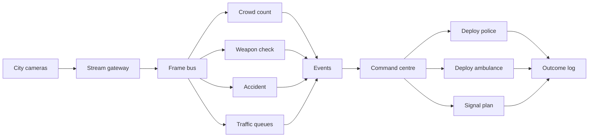
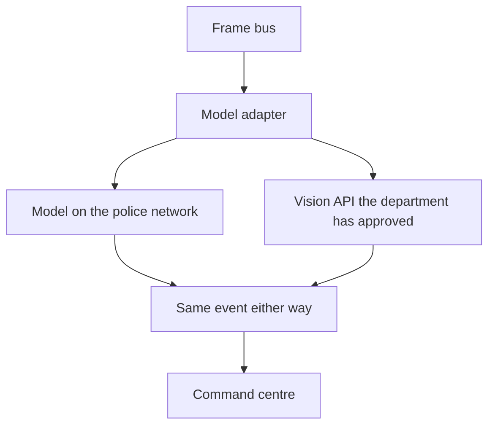
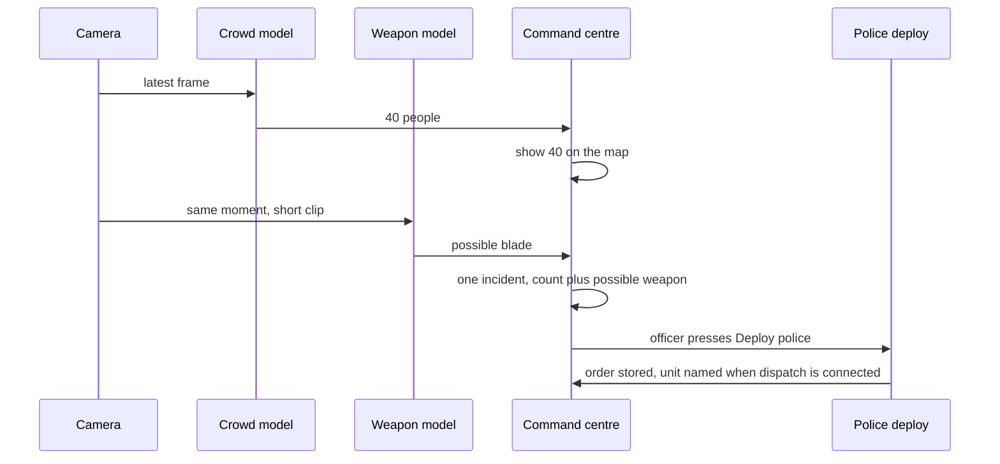
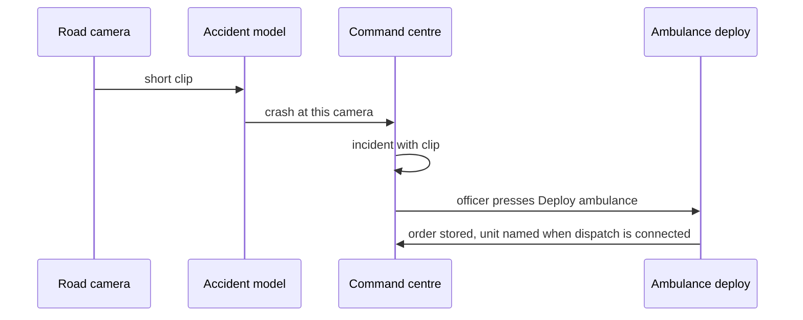
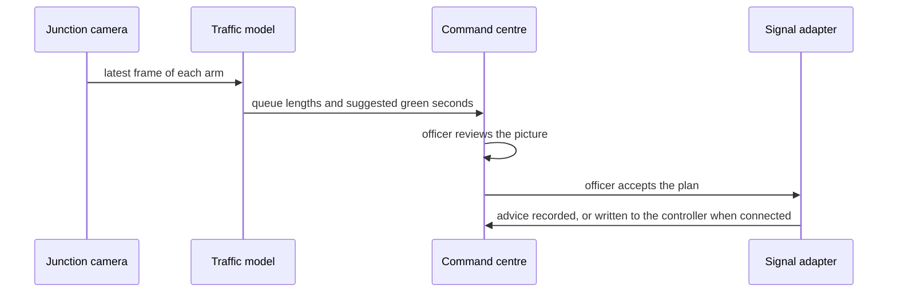

# CityVigilance system architecture

For the command centre, the police department, and the build team. Dated 1 November 2026.

This is the document to hand to someone who needs the whole picture. It explains how city cameras become a people count, a weapon check, an accident alert, and a traffic-signal plan, and how that same design is used first as a demo and later as a deployment.

**Assumption, not a decision.** The operating context is still India: emergency number 112, and traffic conditions that include triple-riding, helmets, and non-standard number plates. No city, camera brand, vision-model vendor, signal controller, or hosting site is chosen.

The earlier screen recording was the command-centre desk only. The alerts on that screen were scripted red-light samples so a person could click dismiss, confirm, and escalate. No city camera was connected. This document is the camera architecture that desk sits on.

## The three situations

These are the situations the command centre must handle. Other detections (number plates, helmets, fire, waterlogging) use the same pipes later. They are not required for the first demo.

**A crowd gathers.** At that camera the screen shows how many people are there, and it keeps updating. If the view also shows a shape consistent with a firearm or a blade, the same incident is marked **Possible weapon**. Police are deployed from that incident.

**An accident happens.** The screen opens an accident incident on that camera, with the clip. An ambulance is deployed from that incident.

**Traffic is building.** The screen shows the queue on each arm of the junction and a suggested green time that clears the longest queue. Traffic staff accept the plan. When the city's signal controller is connected, that acceptance changes the lights. Until then the plan is shown and logged, and a person still changes the lights.

The count, the accident clip, and the queue picture appear as soon as the model has a result. Deploy is a button on that incident. In the demo the button records the order in the command centre. When the department connects its dispatch system, the same button sends the order there. A weapon line stays "possible" until an officer has looked at the clip, because a phone, a tool, or an object in a procession can match a weapon shape.

## One path, from camera to action

Read it left to right.

1. City cameras send live video. For a demo, sample video files stand in for cameras.
2. The stream gateway holds one connection per camera. Models do not log into the camera themselves. One extra login per model would overload the camera.
3. The frame bus keeps the latest pictures and a short clip, about ten seconds, for each camera.
4. Each model reads that bus and answers one question. Crowd count, weapon check, accident, and traffic queues run at the same time on the same pictures.
5. Every model writes an event in the same shape, whether the model runs on the police network or through a vision API.
6. The command centre turns events at the same place and time into one incident.
7. An officer deploys police, deploys an ambulance, or accepts a signal plan.
8. The outcome log stores who acted, on which camera, and what they ordered.

## What each block does

| Block | Job | What can be swapped without rebuilding the desk |
| --- | --- | --- |
| City cameras | Live video from junctions and public places the department already covers | A sample file, a single test camera, or the city's existing camera system |
| Stream gateway | Connect, reconnect, timestamp, and keep the last few seconds | The only block that must know how that camera brand sends video |
| Frame bus | Give every model the same frames and clips | Nothing. New models subscribe. They do not open a new camera connection |
| Models | One question each. Crowd, weapon, accident, queues, and later plates, helmets, fire | A local model or a vision API. The event they emit stays the same |
| Events | A common record: camera, time, finding, clip | — |
| Command centre | Map, live counts, incident, clip, deploy buttons | The screen already started in the project workspace. It still uses scripted alerts until this path is attached |
| Deploy and signal adapters | Carry an accepted order out of the building | Screen-only in the demo. The department's dispatch system and signal controller later |
| Outcome log | Who deployed what, and the clip they saw | — |

**VMS** means the video system the city may already use to watch cameras. **ATCS** means the system that changes green times. **CAD** means the dispatch system that tasks a police or ambulance unit. None of these products is chosen. Each is a plug on the diagram above.

## How several models share one stream

A camera produces one stream. Many models need it. The gateway publishes once. Each model keeps its own pace.

- Crowd count and traffic queues need the latest frame. If a model is still busy, it skips to the newest frame. A stale count is worse than a skipped frame. The screen shows the time of the count.
- Weapon check and accident detection need a short clip, so movement is visible. They read the ten-second buffer.
- A slow model does not stop the others. If the weapon model is waiting on an API, crowd count still updates.
- Adding a model means registering another worker and its finding type. Ingest, the desk, and the log stay as they are.
- Each model sends a heartbeat. If crowd count goes quiet, that camera shows **Count delayed** instead of a number that looks live.

Working rates for the demo, to be measured on real cameras later:

- Crowd count and queue length: about every 2 seconds.
- Weapon check: on the crowd cameras, about every 2 seconds, attached to the current count.
- Accident: continuous on the road cameras, raised when the clip matches a crash.

A vision API is not called on every raw frame. The adapter sends the frame or clip the model needs, at the rate above.

### Local model or vision API

The command centre does not know which path ran. Configuration picks the path per model:

- **Off.** That finding is hidden.
- **Local.** The model runs on machines the department controls. Video stays on that network.
- **API.** The adapter sends the picture to a vision API and maps the reply into the event. Use this in the demo on sample video. Use it on city video only after the department allows pictures to leave the building.

No API vendor is selected. The adapter is the slot where a vendor is named later.

### The event every model must produce

| Field | Meaning |
| --- | --- |
| Camera | Which stream |
| Time | When the picture was taken |
| Model | Crowd, weapon, accident, traffic, or a later model |
| Finding | People count, possible firearm, possible blade, crash, queue length per arm, suggested green seconds |
| Strength | High, or needs review |
| Clip | Pointer to the seconds the officer will watch |

An incident groups findings that share a camera and overlap in time. A crowd of 40 and a possible weapon on that camera are one incident: the count, the weapon line, one clip, one **Deploy police** button. An accident at a junction and a queue at that junction show together on the map. Ambulance deploy and the signal plan remain two actions.

## What the command centre shows

The map is the city area the demo or the deployment covers. Each camera is a point. Placeholder names are used until a real site is chosen.

| Camera kind | Always on the point | What opens an incident |
| --- | --- | --- |
| Crowd place | People count and the time of that count | Count over the limit the department sets, or a possible weapon |
| Junction | Queue length on each arm | A suggested plan that differs from the current greens, or an accident |
| Road | Last time a picture was checked | Accident |

Opening an incident shows the clip, the findings, and the actions that fit:

- Crowd or possible weapon: **Deploy police**
- Accident: **Deploy ambulance**
- Queue plan: **Accept signal plan**
- Any incident: **Dismiss**, with a reason, kept in the log

Dismiss reasons matter. They are how the department later sees false weapon alerts and false crashes.

### Crowd, then police

The count is on the map before anyone is deployed. The weapon line is added when that model speaks. The officer watches the clip, then deploys.

### Accident, then ambulance

Under the India assumption, 112 remains the number the public calls. This incident is the command centre's earlier view of the same kind of event. Linking it to a 112 call is a later connection, not part of the demo.

### Traffic, then the lights

The traffic model proposes green times so a queue is cleared before it blocks the previous junction. It does not move a light by itself. Acceptance is the officer's action. Writing to the controller waits until that controller is named and the department allows the write. A rejected or ignored plan is logged too.

## Demo now, deploy when the project is awarded

Same program. A configuration file changes the plugs. The command-centre screens stay the same, so a demo shown to the department is the system they would run, with live connections still empty.

| Plug | Demo, to show the department | Deployment, after the project is awarded |
| --- | --- | --- |
| Cameras | Three sample videos labeled as cameras: a crowd, a road, a junction. A test camera can replace a file | The department's cameras, through their VMS or a direct stream |
| Models | Demo data plays a prepared story. A file feed runs the person and vehicle detector on CPU. Weapon, crash, and plate readers are not loaded on a file | Local models on the police network, unless the department approves an API for city video |
| Map | Placeholder points. No city is drawn as if it had been chosen | The real camera locations |
| Police and ambulance | **Deploy** records the order, the officer, the time, and the clip on the incident | The same button sends the order to the dispatch system the department names |
| Signals | **Accept signal plan** stores the suggested greens. **Flag this plate** stores a complaint-list hit on the screen and does not stop a vehicle | The same signal button writes to the signal controller the department names. A plate flag follows the city's notice process |
| Accounts | One shared demo desk, labeled Police, Ambulance, or Traffic so the room can see each action | Named officers, with rights set by the department |
| Where it runs | One machine in the room is enough | The network the department requires. On-premises is available because many departments will want video to stay inside. That choice is still open |

If a model is not ready on demo day, that plug can emit timed findings from the sample video. The screen must label those **Sample findings**, so the room does not think a live model ran. As soon as an API or a local model is connected, the same incidents are model findings.

## What the police department needs in place

- The command centre runs for police, traffic, and ambulance desks. One person can hold more than one desk in a small demo.
- Video opens only for those desks. There is no public page of the streams.
- Every deploy stores the officer, the camera, the clip, the finding, and the order.
- How long video and clips are kept is the department's decision. It is not set here.
- Weapon text on screen is **Possible weapon**. The log uses that wording too.
- Signal changes and unit dispatch stay with a person at the desk. The models raise the incident and the recommended action.

## Models the architecture already has room for

Six modules are on the command picture. The rest register on the same bus when the department wants them. Each can be sample, a file feed, a local model, or an API.

| Module | Colour | Demo data | A file feed today | Desk action |
| --- | --- | --- | --- | --- |
| Crowd | Amber | People count on Crowd camera 1, rotating 46 to 53 | Peak people the detector can separate | Deploy police, with movement and weapon, as CR-1 |
| Movement | Violet | Sudden, marked for review | Sudden when the busiest frame is at least 8 people and at least twice the quietest frame. Otherwise steady | Same crowd incident. It does not dispatch by itself |
| Weapon | Rose | Possible blade, because every sample count is at least 40 | Not decided. This detector has no weapon class | Deploy police after a person watches the clip. The line stays **Possible** |
| Accident | Red | Crash on Road camera 1 | Not decided. This detector has no crash class | Deploy ambulance. It does not call 112. RD-1 |
| Traffic | Blue | Queue metres and a green time. North is 31 seconds against a current 20 | Vehicles in the frame, then a stored green of twice that count, between 10 and 60 seconds | Accept signal plan. It does not write to a controller. JN-1 |
| Plates | Teal | `DL01CV0001`, labeled as a demo complaint, not a real registration | Empty. No plate reader is loaded, so a plate is never invented | Flag this plate on the screen. It does not stop a vehicle. PL-1 |

A crowd incident opens when the count is at least 40, or the weapon line is not "none", or movement is sudden. A plate incident opens only when the plate is on the complaint list. An accident incident opens only when crash is true. A null crash means the model has not decided.

## What names the situation

The reading a person can defend in the room comes from the person and vehicle detector, plus the change in that count from frame to frame.

**V-JEPA** (Meta's video joint-embedding model, including V-JEPA 2) was checked as a categoriser. Its public action head is trained on Something-Something v2: hand and object actions such as "putting something into something". That label set does not contain a crash, a weapon, congestion, or a number plate. The model is hundreds of millions to about a billion parameters and is built for a GPU. It is relevant later as a video backbone, after a head is trained on city events the department cares about. It is not the thing that names a crash, a plate, or a weapon in this demo.

A **vision-language model** would write a sentence about the picture, which can help an officer understand a scene. It still must not issue the order. It also needs a GPU the department chooses, or an API, and an API only after the department allows city video to leave the building. This demo machine has no NVIDIA GPU, so no vision-language model is called and no caption is invented.

Weapon, crash, and plate stay undecided on a real clip until those models exist. The demo story is labeled **Demo data** so the room can still see the full loop.

## Two ways to show it

The same screen has two modes. Switching mode clears the log and the attached clips, so the stories do not mix.

**Demo data** is the default. The page is already alive: crowd, sudden movement, a possible weapon, a crash, a signal plan, and a plate on the complaint list. The showcase picture plays with that story. **Watch showcase clip** reloads it. The numbers stay the prepared story until **Read a feed**.

**Live pipeline** emits no sample numbers. The rail says Waiting until **Read a feed** attaches a file. A city camera is not connected. The file is sampled at about one frame a second, up to 12 frames, and YOLOv8n on CPU counts people and vehicles. In Demo data, that same reading replaces the prepared story for that camera only.

Orders in both modes stay on this screen.

## What is still open

These do not change the diagram. They fill the plugs.

1. Which city, which cameras, and which one crowd place and which junctions are first.
2. How those cameras are reached: the existing VMS, or a direct camera stream.
3. Whether each model is local or a named vision API, and whether city video may be sent to that API.
4. Which dispatch system receives police and ambulance orders.
5. Which signal controller, if any, may receive an accepted plan.
6. Cloud, on-premises, or a mix, and who may open live video.
7. The people-count limit that opens a crowd incident, set per place after the first real pictures.

## The command picture

The screen is one command picture, not a stack of department pages.

- A colour rail on the left, one colour per module.
- The picture in the centre: a showcase clip, an attached file, or an empty state.
- The situation on the right: the reading, the mark, and one confirm action.
- A thin outcome log along the bottom.

Police sits on crowd, movement, and weapon. Traffic sits on the signal plan and the plate. Emergency dispatch sits on the accident. Event security reads the same crowd and movement the police desk uses.

Showcase clips, under their original licences in `command-centre/public/showcase/`:

- Crowd, movement, and weapon: Sabana Grande boulevard, Caracas. Vicente Quintero, CC BY 3.0.
- Traffic and plates: Link Road, Cuttack. Subhashish Panigrahi, CC BY-SA 3.0.
- Accident: a truck collision on the A1. CaughtOnDashcamOrCCTV, CC BY 3.0. The wreck is visible. The accident model still leaves the decision with the officer.

## Where the current screen fits

The command centre in `command-centre/` (`cd command-centre && npm run dev`, http://127.0.0.1:5173) is this demo. The model service is `python -m cityvigilance.server` on http://127.0.0.1:8765. The same sample rules live in `cityvigilance/sample.py`. `notebooks/06_demo_and_live.ipynb` walks the two modes, the six readings, and why V-JEPA is not the categoriser. **Deploy police**, **Deploy ambulance**, **Accept signal plan**, and **Flag this plate** record orders on the incident. City cameras, a vision API, dispatch, and a signal controller are the same plugs with nothing attached yet. Deployment changes those plugs, not the desk.

The sample models and the file detector run on the CPU of whichever machine starts them. This demo does not use a GPU and does not call a vision server. A later local model would use a GPU on a machine the department chooses. A later API model would use the provider's servers, and only if city video is allowed to leave the building.
